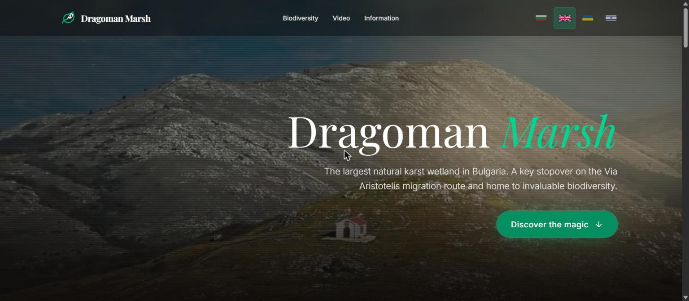
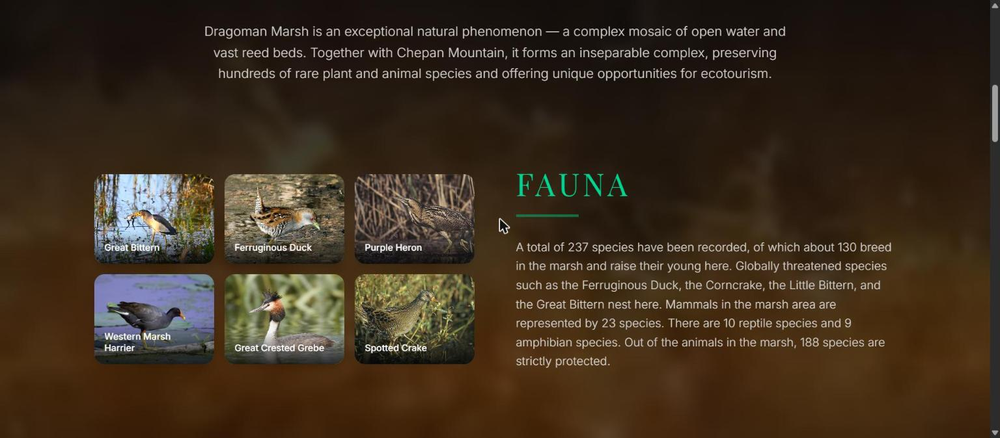
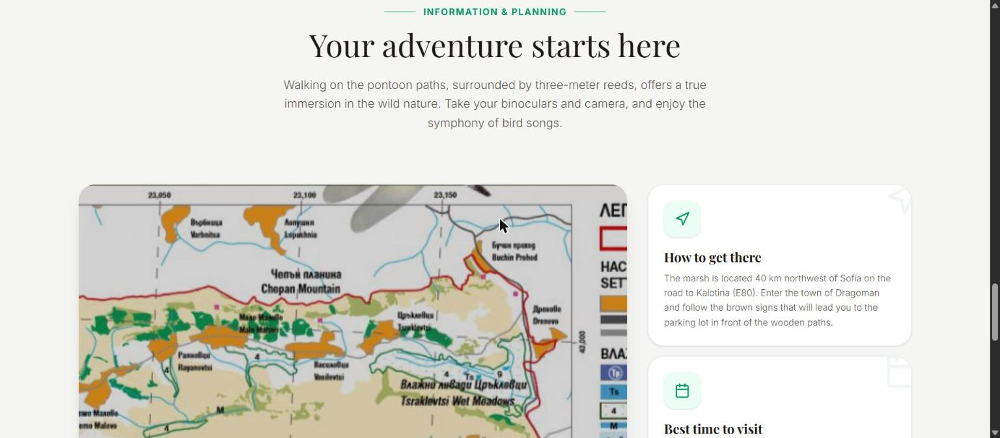
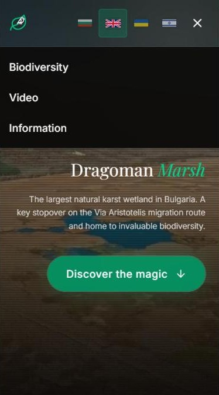
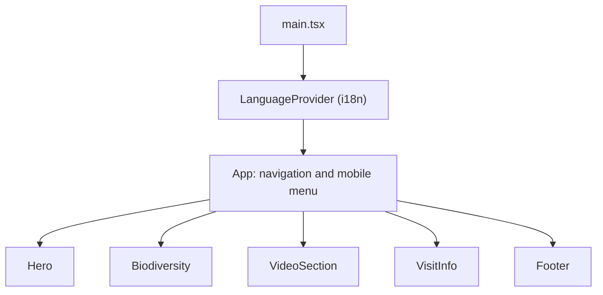
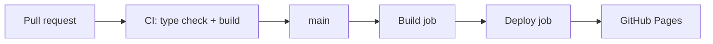

<div align="center">

# Dragoman Marsh — The Oasis of Wild Nature 🌿🐦

**An interactive, multilingual website about the largest natural karst wetland in Bulgaria.**

[**Live site**](https://gurmeta.github.io/dragoman-marsh/) · [Architecture](docs/ARCHITECTURE.md) · [Changelog](CHANGELOG.md) · [Contributing](CONTRIBUTING.md)

[](https://github.com/Gurmeta/dragoman-marsh/actions/workflows/deploy.yml)
[](https://github.com/Gurmeta/dragoman-marsh/actions/workflows/ci.yml)
[](https://github.com/Gurmeta/dragoman-marsh/releases)
[](LICENSE)




</div>

## Table of contents

- [About the marsh](#about-the-marsh)
- [Features](#features)
- [Screenshots](#screenshots)
- [Tech stack](#tech-stack)
- [Architecture](#architecture)
- [Project structure](#project-structure)
- [Getting started](#getting-started)
- [Deployment](#deployment)
- [Accessibility, privacy and performance](#accessibility-privacy-and-performance)
- [Documentation](#documentation)
- [Credits and media](#credits-and-media)
- [License](#license)

## About the marsh

Dragoman Marsh (Драгоманско блато) lies 40 km northwest of Sofia at the foot of Chepan Mountain. It is a key stopover on the **Via Aristotelis** bird migration route.

The complex hosts **256 bird species** (61% of the country's ornithofauna), 43 mammal species, 11 reptile species, 9 amphibian species and 180 species of higher plants, many of them endemic to Bulgaria and the Balkan Peninsula. Globally threatened birds such as the Ferruginous Duck and the Corncrake nest here, alongside rare plants like the White Water Lily and the Meadow Violet, listed in the Red Book of Bulgaria.

## Features

- **Biodiversity showcase** — an interactive gallery of emblematic bird and plant species, each opening a detailed description.
- **Multimedia experience** — video backgrounds, a panoramic drone film and a video presentation.
- **Visitor information** — how to get there, the best seasons for birdwatching, the wooden pontoon trails, the autumn bird-ringing camp and an enlargeable map of the complex.
- **Four languages** — Bulgarian, English, Ukrainian and Hebrew, with full right-to-left layout for Hebrew. The choice is remembered between visits.
- **Responsive and touch friendly** — a dedicated mobile menu and 44 px touch targets.
- **Accessible** — keyboard navigation, dialogs that close with Esc, reduced-motion support and translated labels.

## Screenshots

| Biodiversity | Visitor information | Mobile menu |
|---|---|---|
|  |  |  |

## Tech stack

| Area | Technology |
|---|---|
| Framework | [React 19](https://react.dev/) |
| Build tool | [Vite 6](https://vitejs.dev/) |
| Language | [TypeScript](https://www.typescriptlang.org/) (strict mode) |
| Styling | [Tailwind CSS v4](https://tailwindcss.com/) |
| Animation | [Motion](https://motion.dev/) |
| Icons | [Lucide](https://lucide.dev/) |
| Fonts | [Inter](https://rsms.me/inter/) and [Playfair Display](https://fonts.google.com/specimen/Playfair+Display), self-hosted via Fontsource |
| Hosting and CI/CD | GitHub Pages, GitHub Actions, Dependabot |

## Architecture

A static single-page app: no backend, no database, no tracking.



Build and delivery pipeline:



More detail, including the i18n flow and design decisions, is in [docs/ARCHITECTURE.md](docs/ARCHITECTURE.md).

## Project structure

```text
.
├── .github/              # CI and deploy workflows, Dependabot, issue and PR templates
├── docs/                 # Architecture notes, media guide, screenshots
├── public/               # Videos, posters, social image, robots.txt, sitemap.xml
├── src/
│   ├── components/       # Hero, Biodiversity, VideoSection, VisitInfo, Footer, Logo, Flags
│   ├── hooks/            # usePrefersReducedMotion
│   ├── i18n.tsx          # Translations (bg, en, ua, he) and language provider
│   ├── App.tsx           # Layout, navigation, mobile menu
│   ├── index.css         # Tailwind setup and fonts
│   └── main.tsx          # Entry point
├── index.html            # HTML shell with SEO and social metadata
└── vite.config.ts        # Vite config (base path for GitHub Pages)
```

## Getting started

Requires **Node.js 22** or newer (see [`.nvmrc`](.nvmrc)).

```bash
git clone https://github.com/Gurmeta/dragoman-marsh.git
cd dragoman-marsh
npm ci
npm run dev
```

The dev server runs at http://localhost:3000.

| Script | What it does |
|---|---|
| `npm run dev` | Start the development server |
| `npm run build` | Create a production build in `dist/` |
| `npm run preview` | Serve the production build locally |
| `npm run lint` | TypeScript type check |
| `npm run check` | Type check and production build, as CI runs them |
| `npm run clean` | Remove `dist/` |

No environment variables or secrets are required.

## Deployment

Every push to `main` triggers [`deploy.yml`](.github/workflows/deploy.yml), which type-checks, builds and publishes `dist/` to GitHub Pages. Pull requests run [`ci.yml`](.github/workflows/ci.yml) first. The build job is read-only; only the deploy job has Pages permissions.

Vite's `base` is `/dragoman-marsh/` on GitHub Actions and `/` locally. If the repository is renamed, update `base` in [`vite.config.ts`](vite.config.ts) and the URLs in `index.html`, `package.json` and this README.

## Accessibility, privacy and performance

- **Accessibility:** semantic buttons and dialogs, Esc to close, focus restored on close, visible focus rings, `prefers-reduced-motion` respected, labels translated in all languages.
- **Privacy:** self-hosted fonts, privacy-enhanced YouTube embeds (`youtube-nocookie.com`), no analytics, and the site itself sets no cookies. Only the chosen language is stored in `localStorage`.
- **Performance:** background videos compressed from 35.7 MB to about 10.9 MB with poster frames, lazy-loaded images and iframes, and variable fonts served from the same origin.
- **SEO and sharing:** canonical URL, Open Graph and Twitter card tags, `robots.txt` and `sitemap.xml`.

## Documentation

| Document | Contents |
|---|---|
| [docs/ARCHITECTURE.md](docs/ARCHITECTURE.md) | Component tree, i18n flow, deployment pipeline, design decisions |
| [docs/MEDIA.md](docs/MEDIA.md) | How videos and images are optimised |
| [CONTRIBUTING.md](CONTRIBUTING.md) | Setup, workflow and conventions |
| [SECURITY.md](SECURITY.md) | How to report a vulnerability |
| [CHANGELOG.md](CHANGELOG.md) | Release history |

## Credits and media

Website created based on an idea by **Georgi Stefanov**.

Photographs of species and the map of the complex are displayed from [visitdragoman.com](https://visitdragoman.com/), and several originate from Wikimedia Commons contributors. Photographs, videos and the map remain the property of their respective authors and are **not** covered by the MIT license. If you are a rights holder and want a credit added or an item removed, please open an issue.

## License

The source code is released under the [MIT License](LICENSE).
