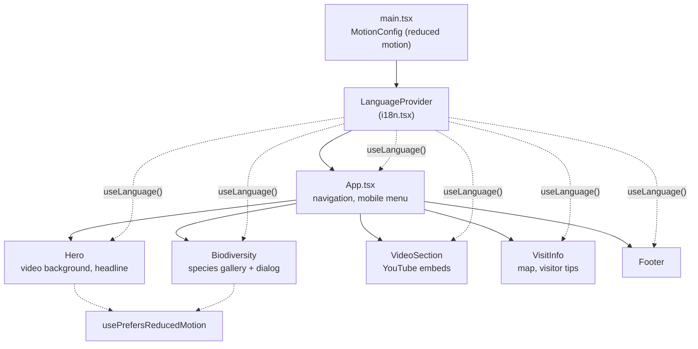
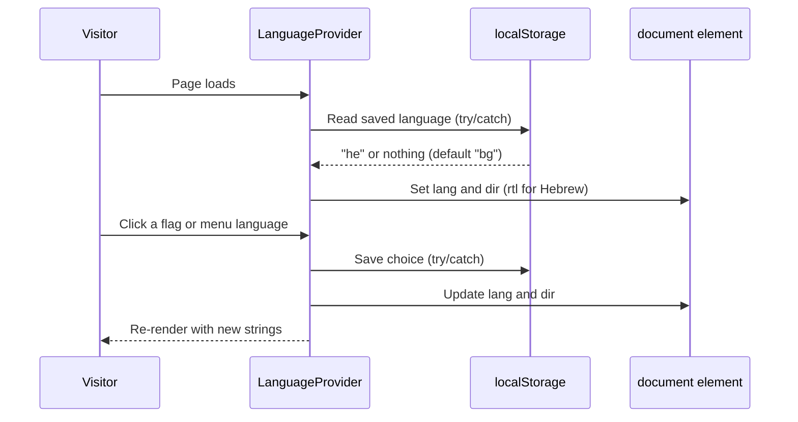
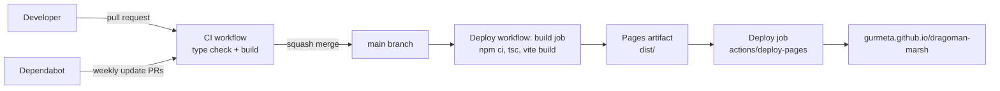

# Architecture

The site is a single-page React application compiled to static files by Vite and served from GitHub Pages. There is no backend, database or API.

## Component structure

| Path | Responsibility |
|---|---|
| `src/main.tsx` | Entry point; wraps the app in `MotionConfig` and `LanguageProvider` |
| `src/App.tsx` | Fixed navigation bar, language switcher, mobile menu and page layout |
| `src/i18n.tsx` | All translations (`bg`, `en`, `ua`, `he`), `LanguageProvider` and `useLanguage()` |
| `src/components/` | One component per page section, plus `Logo` and `Flags` |
| `src/hooks/usePrefersReducedMotion.ts` | Reads the `prefers-reduced-motion` media query |
| `public/` | Static assets copied as-is: videos, posters, social image, `robots.txt`, `sitemap.xml` |

## Internationalisation

Translations are a typed object keyed by language. The type of `translations.bg` is used as the contract for every other language, so a missing key in `en`, `ua` or `he` is a compile-time error.

Ukrainian uses the internal code `ua`; the HTML `lang` attribute is mapped to the ISO code `uk`.

## Build and deployment

- Vite's `base` is `/dragoman-marsh/` when `GITHUB_ACTIONS=true` and `/` locally, so assets resolve both on GitHub Pages and on the dev server. If the repository is renamed, update `base` in `vite.config.ts`, the URLs in `index.html` and `package.json`, and the README links.
- The build job has read-only permissions; only the deploy job receives `pages: write` and `id-token: write`.

## Design decisions

| Decision | Reason |
|---|---|
| Self-hosted fonts (`@fontsource-variable`) | No third-party requests, better privacy (GDPR) and faster first paint; includes Cyrillic |
| `youtube-nocookie.com` embeds with `loading="lazy"` | Fewer tracking cookies and no video bytes until the section is near the viewport |
| Compressed, muted background videos with posters | About 10.9 MB total instead of 35.7 MB; the poster shows instantly and is used when motion is reduced |
| Real `<button>` elements and `role="dialog"` | Keyboard and screen-reader access; Esc closes dialogs and focus returns to the trigger |
| `strict` TypeScript and a typed translation contract | Catches missing translations and null errors at build time |
| `localStorage` access wrapped in `try/catch` | The site keeps working when storage is blocked (private mode, strict settings) |

## Known limitations

- Species and map photographs are loaded from `visitdragoman.com`, a third-party host. If that site changes or blocks hotlinking, the images will not load. Moving them into `public/` is the long-term fix once publishing rights are confirmed.
- The app is client-rendered, so crawlers that do not run JavaScript only see the HTML shell (title, description and social metadata are present in `index.html`).
